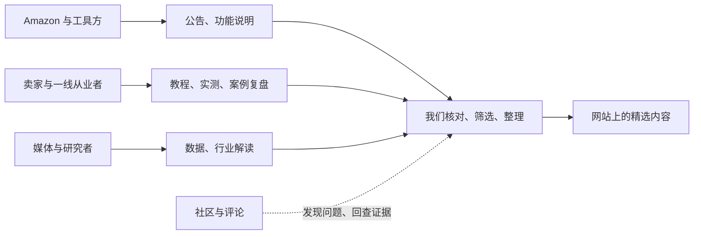

# 信息链与首批信源

研究日期：2026-10-28。栏目已确认：**全部｜行业动态｜教程（新人入门与进阶）｜案例｜工具｜AI营销**。

本轮检查了 23 个候选入口，并额外核对了资料库的语言版本和中文新闻索引；抓取了 16 篇样本页面。建议首批保留 9 个入口，覆盖 7 个发布主体。这里是接入建议，不代表已启动监控，也不是完整的全球信源普查。具体检查记录与可复用的读取参数见 [信源.json](信源.json)。

## 信息从哪里来

信息不只从官方公告一路向下流动。卖家可能先发现问题、先试出一种方法，官方后来才解释；工具方也可能先发布新能力，再由用户验证。我们既要盯变化的源头，也要找实际做事的人。

- **变化从哪里发布：**Amazon Ads、卖家博客、官方新闻与工具方说明。重点核对发生了什么、适用对象、地区与开放状态。
- **方法在哪里产生：**卖家、运营、服务商和创作者的实际工作。优先找有步骤、案例背景和限制的文章或节目讲义。
- **趋势在哪里被看见：**研究者、媒体和有数据的从业者。保留其方法和数据来源，不能把推测改写成平台规则。
- **问题在哪里冒出来：**论坛、评论和社交讨论。用来发现线索、了解读者困惑；涉及平台变化时回查公告或其他证据。

## 挑信源的办法

看它能持续补充什么信息，再看能否低成本、稳定获取。至少检查实际文章、近期更新、原文与日期、获取方式及商业背景。

1. 内容能帮助 Amazon 商品营销、获得流量或使用相关 AI 方法。只有公司介绍、营销报名页或泛电商话题，不足以成为日常信源。
2. 允许基础知识与进阶实践并存。旧的好教程可作为学习样本，不能伪装成今天的新消息。
3. 优先公开文字、RSS 和有讲义的节目。页面能打开，不等于列表、正文和日期都能稳定提取；收费或复杂入口暂列候选。
4. 平台、服务商和工具方都有价值。其案例和效果是自述时明确说明，产品发布也不等于我们推荐购买。
5. 不虚设总分和入选门槛。先按具体价值和障碍取舍，再用后续真实内容检验。

## 建议首批保留的 9 个入口

| 信源 | 补充什么 | 本轮抽看的内容 | 获取情况与取舍 |
|---|---|---|---|
| [Amazon Ads 更新](https://advertising.amazon.com/en-us/resources/whats-new) | 广告功能与平台变化，行业动态的源头 | [DVA+ 公告](https://advertising.amazon.com/resources/whats-new/dva-plus-display-video-audio-campaigns)（9 月 29 日）、[地理洞察新功能](https://advertising.amazon.com/en-ca/resources/whats-new/geographic-insights-activation-pre-built-indices)（10 月 2 日） | 详情可读；原始列表主要是动态内容，只取到少量置顶卡片。必须适配列表或另找稳定入口，不能按置顶内容判断最新消息。 |
| [Amazon 卖家博客](https://sell.amazon.com/blog) | 店铺、搜索、促销、商品内容、入门教学 | [品牌分析指南](https://sell.amazon.com/blog/brand-analytics)（10 月 20 日）、[品牌定制促销教程](https://sell.amazon.com/blog/brand-tailored-promotions)（1 月 20 日） | 普通网页可取到 9 条去重后的标题、链接和日期。只保留营销相关内容，物流与一般开店运营不过量引入。 |
| [Amazon Ads 资料库](https://advertising.amazon.com/en-us/resources/library) | 官方教程、案例和专家文章 | [WD-40 使用 AI 视频的案例](https://advertising.amazon.com/en-gb/library/case-studies/wd-40-and-bizon/) | 详情可读，完整列表同样需要适配。案例结果注明来源；页面未明确发布时间时保持未知，不能用案例发生年份代替发布时间。 |
| [Ad Badger](https://www.adbadger.com/blog/) | 广告入门与进阶教程、PPC Den 节目 | [预算分配教程](https://www.adbadger.com/blog/amazon-ppc-education/amazon-ppc-budgets-the-how-to-guide/)（10 月 20 日）、[AI 技能的节目说明](https://www.adbadger.com/blog/free-ai-skills-find-your-amazon-ppc-wasted-spend-n-grams-the-ppc-den-podcast/)（10 月 23 日） | RSS 成功读取 6 条，提供摘要，需再取正文。长教程与节目简短介绍要区分；没有完整文字时不能替音频编写结论。该站同时销售广告软件与服务。 |
| [My Amazon Guy](https://myamazonguy.com/) | 搜索、商品页、内容与广告实操 | [大促预算教程](https://myamazonguy.com/advertising/cyber-five-budget-for-sponsored-ads-and-dsp/)（10 月 19 日）、[评论与搜索的经验文章](https://myamazonguy.com/seo/amazon-review-strategy-to-improve-search-ranking/)（10 月 21 日） | RSS 成功读取 10 条，带正文。排除物流、机构排名等无关内容；作者对排名机制的解释按经验或推测呈现，不能写成官方算法。 |
| [Intentwise](https://www.intentwise.com/blog) | 进阶实践、工具工作流、AI 使用案例 | [Amazon 业务中的 Claude 技能](https://www.intentwise.com/blog/4-claude-skills-for-your-amazon-business)（10 月 19 日）、[三家公司使用 Claude 的案例](https://www.intentwise.com/blog/how-3-businesses-sped-up-amazon-analytics-with-claude)（9 月 8 日） | 网页可取到 13 条标题、链接和日期，包含置顶条目。保留具体工作流；Walmart 等无关内容筛掉，厂商案例注明自述。 |
| [Helium 10 博客](https://www.helium10.com/blog/) | 新人教学、工具用法、商品内容与 AI 教程 | [用 AI 写商品内容时减少编造的方法](https://www.helium10.com/blog/how-to-prompt-ai-and-avoid-hallucinations-for-amazon-listings/)（10 月 26 日）、[AI 工具的机构案例](https://www.helium10.com/blog/reduce-keyword-analysis-time-with-our-new-agent-helium/)（10 月 21 日） | 网页可取到 12 条标题、链接和日期；RSS 本次在脚本和网页读取中均超时，先走网页。过滤选品、其他平台和纯优惠宣传。 |
| [Marketplace Pulse](https://www.marketplacepulse.com/articles) | 行业观察、数据与搜索流量变化 | [Amazon AI 与商品排名的观察](https://www.marketplacepulse.com/articles/amazons-ai-doesnt-read-the-rankings)（7 月 16 日） | Atom 成功读取 20 条。最新条目为 10 月 9 日的 TikTok 研究，不能直接当成本项目内容；只收与 Amazon 营销直接相关的文章。旧样本用于校准，不进入今天的热点。 |
| [Adbrew](https://adbrew.io/blog) | 工具更新、广告与 AI 的具体用法 | [广告 MCP 工具的能力比较与自家方案](https://adbrew.io/blog/not-all-amazon-ads-mcps-are-built-equal)（10 月 27 日） | 网页含日期与链接，详情可读；响应式卡片重复多，标题也需要取详情页核对。接入前补卡片去重和标题检查。厂商自评不当作中立评测。 |

以上 9 个是入口数，不是 9 个独立发布主体：Amazon 的三个入口归同一主体。Helium 10 与后备的 Pacvue、AM/PM 节目也不能直接当成彼此独立的信源。[Helium 10 官方介绍](https://www.helium10.com/about/)说明其属于 Pacvue 体系。

## 本轮没有优先接入的来源

| 候选 | 保留或延后的原因 |
|---|---|
| [Seller Sessions](https://sellersessions.com/episodes/) | 普通 RSS 最新条目为 2 月 5 日，节目 RSS 则更新到 10 月 15 日。后者有文字，但近期内容较多涉及通用 AI 和经营自动化；优先选营销、商品图片和搜索相关节目。历史长文可补进阶样本。 |
| [Ritu Java 的 AI for E-Commerce](https://www.ppc-ninja.com/) | 找到了作者自己的公开 Newsletter，网页工具能读到 10 月 25 日更新；本机请求被 403 拦截。值得持续观察，先人工选与营销直接相关的文章，不为此给 MVP 增加付费采集。 |
| [Pacvue 博客](https://pacvue.com/blog/) | 原创研究、工具消息有价值，但本机请求 403；先保留公开可核对的个别内容。 |
| [Pacvue 案例](https://pacvue.com/customerstories/) | 浏览工具能读到案例，本机请求 403。后备案例来源，结果按厂商自述标明，不能当作同样操作必然得到的结果。 |
| [AM/PM Podcast](https://ampmpodcast.podbean.com/) | 网页工具能读到近期的实操访谈与 AI 引流案例，但本机请求失败。先从 Helium 10 的文字页面补内容，避免为同一主体重复建设入口。 |
| [Jungle Scout](https://www.junglescout.com/resources/articles/) | 网页可读，工具教学与研究有价值；与现有工具商内容重叠较多，先作为补充。只选有新增方法或数据的文章。 |
| [SmartScout](https://www.smartscout.com/blog) | 网页可读，有营销、AI 工具与数据文章；列表中工具榜单和替代品文章较多，先筛选具体方法、原创数据与实际使用说明。 |
| [Perpetua](https://perpetua.io/blog/) | 网页可读，有工具更新，但首页部分推荐文章较旧；先作为补充，不把置顶顺序当发布时间。 |
| [Junglr](https://junglr.com/blog/) | RSS 可读，但最新条目为 4 月 7 日，前两条是下载/预约类内容。现有博客不适合作为日常更新源；作者本人的其他公开渠道以后再找。 |
| [Ad Advance](https://adadvance.com/blog/) | 网页可读，观察到最近有日期的列表条目为 4 月 9 日。保留旧的进阶教程，不优先作为新消息来源。 |
| [About Amazon 零售新闻](https://www.aboutamazon.com/news/retail) | 有官方新消息，但全站 RSS 只返回 10 条，本次多为其他业务新闻。先按零售/购物/营销主题找原文，不把全站 RSS 直接接进来。 |
| [Amazon Seller Forums](https://sellercentral.amazon.com/forums/c/news/2) | 页面可打开，但新闻入口可能展示公告与用户讨论的混合内容。要核对发布者身份，暂作为公告补充与问题线索，不能把普通卖家发言写成官方结论。 |
| [亚马逊中国新闻中心](https://gs.amazon.cn/news-center) | 已定位公开索引并读到 10 月 15 日内容；同时有大量供应链、大会与政策消息。中文官方来源保留，按营销价值选取；与其他 Amazon 官方入口合并主体。 |
| [卖家精灵](https://cn.sellersprite.com/v3/knowledge) | 本机拿到的是空的前端外壳。另找到公开 AI 广告专场介绍，但报名介绍不等于课程内容；需要找到可读的实际教程，再决定接入方式。 |

## 这次实测改变了哪些判断

- **RSS 可读也可能没用。**8 个已发现的订阅地址中，7 个解析成功，1 个超时；其中还有低相关全站流、停更博客和占位内容，不能全接。
- **没有找到可用 RSS，也不等于要上浏览器。**卖家博客、Intentwise、Helium 10 的原始网页已经能取到合计 34 条去重后的标题、链接和日期。这里是样本读取验证，还不是 AIHOT 生产采集验收。
- **日期会制造假新鲜。**本次 Amazon Ads 的两篇公告发布时间分别是 9 月 29 日、10 月 2 日，结构化数据却都有 10 月 28 日的修改日期。不能把修改日期或列表置顶顺序当成新消息。
- **一篇文章可以同时服务几个栏目。**AI 写商品内容的教程可同时出现在教程与 AI营销；工具使用案例可同时出现在案例、工具与 AI营销，不需要强制单选。
- **研究和案例仍有偏向。**首批有不少平台、服务商和工具商内容。缺口是真实卖家的长期复盘、失败实验和更独立的工具评测，需要在试读中继续补，不用厂商宣传填满栏目。

## 下一步直接怎么用

先用 6 个获取路径较简单的入口验证内容：Amazon 卖家博客、Ad Badger、My Amazon Guy、Intentwise、Helium 10、Marketplace Pulse。其中 3 个 RSS/Atom 与 3 个网页列表的检查结果已记录。

同时把 Amazon Ads 更新、官方资料库和 Adbrew 的列表问题列为接入任务：有价值的内容不因采集稍难而丢掉，但不先为所有后备来源建设复杂抓取。

第一批取小量新文章与学习样本，看是否真的能覆盖行业动态、入门/进阶教程、案例、工具和 AI营销，记录漏选与误选的理由，再决定扩源。原文的地区、适用对象、预告状态和案例前提都要保留。未调用付费采集、未开自动任务；`industry/sources.json` 仍待后续接入时更新。
