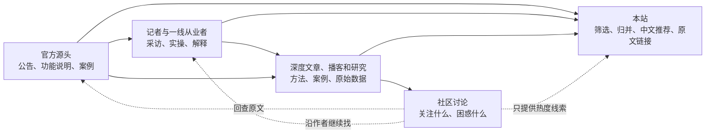

# 信源

核对日：2026-10-28。范围：跨境电商，先做Amazon的营销、流量及相关AI内容。栏目保持：全部｜行业动态｜教程（新人入门与进阶）｜案例｜工具｜AI营销。

## 这轮结果

从第一轮23个候选扩展到 **167个候选入口**；合并7个同一主体或节目替代入口后为 **160条**。它们不是160家相互独立的公司，机构旗下的不同频道还需要识别关系。

- **推荐39条**：本轮已有近60天发布证据、可读正文或公开摘要，以及可行读取入口；经过六项初评分。
- **暂不推荐19条**：具备基本证据，但在当前范围内相关性、深度、独有信息、更新频率或读取成本不占优。不是永久黑名单。
- **排除35条**：当前公开频道超60天未更新、主要离题，或实际内容已变成博彩等；逐条保留理由。
- **待核实66条**：日期、正文、当前频道或替代读取路径证据未齐，不混入推荐池，也不凭一次403就判永久不可抓。
- **热度入口1条**：知无不言；用于发现问题和讨论量，不直接当新闻事实源。

共保存 **251条页面提取与核对记录，涉及114个来源域名**。其中有服务页、目录页、过期置顶和读取失败，不能说成“精读251篇文章”。另整理了[12个编辑判断例子](信源样本.md)，属于Agent初判，尚未经过用户内容标注。

这份研究替代第一轮9个入口的建议，**尚未配置生产采集，也未验证定时更新**。MVP控制接入和建设规模，研究范围保持开放。

## 信息怎样流动

这四层是找内容的路径，不是要加到网站上的四个栏目。前三层都可提供内容，社区主要提供问题与热度。官方优势是确认规则和产品状态；作者与记者补充理解、实践与独立观察。

## 实际走过的关联路径

| 起点 | 沿什么关系寻找 | 得到什么 |
|---|---|---|
| [Feedspot卖家订阅目录](https://rss.feedspot.com/amazon_seller_rss_feeds/)、[广告播客目录](https://podcast.feedspot.com/amazon_advertising_podcasts/)及MillionPodcasts | 目录中的官网、RSS、节目主页 | 扩大候选池；目录只作线索。实际发现停更、错误入口及博彩内容，不能沿用目录的质量背书。 |
| [Adbrew的教程](https://adbrew.io/blog/reduce-acos-on-amazon) | 正文外链和引用 | 找到PPC Land等报道，再追官方出处；从大促文章的研究引用找到Adobe原始研究。 |
| [Retailgentic的频道合作公告](https://www.retailgentic.com/p/announcing-retailplaybook-new-channel) | 被推荐的作者、新频道 | 找到Andrew Bell的RetailPlaybook，核到公开RSS和近期研究长文。 |
| [RetailPlaybook的AI商品图访谈](https://www.retailplaybook.ai/p/dont-generate-images-just-because) | 嘉宾及其自有机构、工具 | 核对AMZ One Step的作者关系与AI商品图实践；这类关联能把工具推荐推进到真实使用过程。 |
| [BTR节目主页](https://www.btrmedia.com/resources/podcast) | 官网指向Apple节目，再查公开节目目录中的发行方feedUrl | 找到Riverside发行方RSS；核到2026-10-27的美妆品牌Amazon访谈。只是公开节目介绍，不冒充逐字稿。 |
| Kiri Masters的旧Substack入口 | 同一作者的独立网站和公开RSS | [Retail Media Breakfast Club](https://retailmediabreakfastclub.com/)持续更新；旧入口读取失败不等于作者停更。 |
| Jungle Scout、Seller Sessions等旧RSS | 同品牌的文章栏目、节目专用订阅 | Jungle Scout改用当前文章HTML；Seller Sessions查到/episodes/feed/而非旧/feed/。但后者近期样本偏通用经营AI，已撤下首批建议。 |
| 中文主题和作者对照检索 | 检查已有中文解释、同品牌中文渠道 | 发现官方中文教程、Pacvue中文传播及PPCWISER等候选；不因文章是英文就给稀缺高分。 |

方法上借鉴[引用追踪](https://www.library.sydney.edu.au/support/searching/citation-chaining)的前后关联思路，以及[Inoreader的找订阅入口方法](https://www.inoreader.com/features/find-feeds)：先找一篇好内容，再追引用、作者、合作对象与实际发布渠道。本轮没有购买目录、订阅付费内容或开通第三方采集服务。

## 首批建议接入12条

这12条按内容互补性选出，**不是单纯按总分取前12**。39条保留为扩展池；不把其余推荐来源丢掉，也不要求第一版同时接入39条。以下是建议，尚未替用户确认或写入运行配置。

| 来源 | 给读者带来什么 | 已确认的研究读取路径 |
|---|---|---|
| [Amazon Ads](https://advertising.amazon.com/en-us/resources/whats-new) | 新规则、新功能的源头 | 公开HTML；生产适配未测试 |
| [Amazon 卖家博客](https://sell.amazon.com/blog) | 入门教学、品牌和商品页面 | 公开HTML；生产适配未测试 |
| [Marketplace Pulse](https://www.marketplacepulse.com/articles) | 记者分析、行业变化 | 发行方公开RSS/Atom；生产适配未测试 |
| [Ad Badger / PPC Den](https://www.adbadger.com/blog/) | 广告实操、AI用法 | 发行方公开RSS/Atom；生产适配未测试 |
| [Intentwise](https://www.intentwise.com/blog) | 工具更新、AI工作流 | 公开HTML；生产适配未测试 |
| [Helium 10](https://www.helium10.com/blog/) | 关键词、Listing与AI教程 | 公开HTML；生产适配未测试 |
| [AM/PM Podcast](https://www.ampmpodcast.com/) | 站外引流、品牌访谈，有逐字稿 | 公开HTML；生产适配未测试 |
| [Scale Insights](https://blog.scaleinsights.com/) | 一线案例、AMC、AI应用复盘 | 发行方公开RSS/Atom；生产适配未测试 |
| [BellaVix](https://www.bellavix.com/) | AI商品图、页面制作的真实流程 | 发行方公开RSS/Atom；生产适配未测试 |
| [RetailPlaybook / Andrew Bell](https://www.retailplaybook.ai/) | Amazon AI搜索、原创研究和方法 | 发行方公开RSS/Atom；生产适配未测试 |
| [Clear Ads](https://clearadsagency.com/) | 广告进阶、B2B与适用条件 | 发行方公开RSS/Atom；生产适配未测试 |
| [Incrementum Digital](https://incrementumdigital.com/media) | 有统计口径的大促与品牌复盘 | 公开HTML；生产适配未测试 |

官方动态索引有旧置顶卡片，接入时必须修正列表发现和日期读取；不能把研究阶段用搜索找到详情页等同于自动采集已跑通。播客只在存在可读文字的范围内做摘要，第一版不要求音频转录。

## 其余27条推荐

| 来源 | 主要补充内容 |
|---|---|
| [My Amazon Guy](https://myamazonguy.com/feed/) | 搜索、详情页与品牌运营教程多，可覆盖基础教学。 |
| [Perpetua](https://perpetua.io/blog/) | 自有MCP发布、品牌词策略及客户案例。 |
| [BTR Media / Destaney Wishon](https://api.riverside.fm/hosting/Xu0fApI9.rss) | 品牌负责人访谈，已找到美妆品牌如何做Amazon营销的近期一期。 |
| [Ecommerce Braintrust](https://www.ecommercebraintrust.com/episodes) | 从业团队有署名讨论，提供会议解读和实际经营视角。 |
| [Acadia](https://acadia.io/feed/) | 署名操盘手解释AMC、品牌与广告的关系，能提供经验而非只有公告。 |
| [Intero Digital](https://www.interodigital.com/feed/) | 公开RSS有Amazon AI与营销讨论的文字内容。 |
| [Canopy Management](https://canopymanagement.com/resources/) | 新功能、详情页和广告基础内容互补，解释中有适用条件。 |
| [Tinuiti](https://tinuiti.com/blog/?filter-topic=amazon) | Amazon广告长篇教程和机构实践，适合进阶内容。 |
| [SellerApp](https://www.sellerapp.com/blog/feed/) | DSP入门、AMC等教程覆盖初学与进阶，有预算前提说明。 |
| [Seller Labs](https://www.sellerlabs.com/feed/) | AI调价、Amazon数据接入的产品解释，适合AI营销工具和边界讨论。 |
| [m19](https://www.m19.com/blog) | 技术团队解释自家AI广告引擎，属于工具作者的一手说明。 |
| [AMZ One Step](https://amzonestep.com/blog/) | AI商品图、A+内容的制作步骤，补上创意制作方向。 |
| [Kiri Masters / Retail Media Breakfast Club](https://retailmediabreakfastclub.com/rss/) | 独立作者、从业者对话和研究讨论，能提供观点与研究线索。 |
| [Retailgentic / Scot Wingo](https://www.retailgentic.com/feed) | 跟踪AI购物，并沿作者合作关系引出专做Amazon的RetailPlaybook。 |
| [Skai](https://skai.io/blog/) | 有现场解读和自有零售媒体研究，可追到原始报告。 |
| [Teikametrics](https://www.teikametrics.com/feed/) | 从工具与商品内容角度解释AI购物，有具体内容检查方法。 |
| [CommerceIQ](https://www.commerceiq.ai/blog) | Amazon AI搜索、商品内容准备及MCP的产品与策略说明。 |
| [Stackline](https://www.stackline.com/news) | 自有购物和广告数据、大促复盘，补充行业研究。 |
| [Channel Key](https://www.channelkey.com/blog-feed.xml) | 真实客户的订阅与DSP推广案例，适合案例板块。 |
| [Front Row](https://www.frontrowgroup.com/en/insights) | 大促选品、品牌营销及促销打法，适合教程和案例。 |
| [Ecommerce Nurse](https://ecommercenurse.com/feed/) | 品牌与私牌、广告和页面问题的从业解释，内容直接。 |
| [Practical Ecommerce](https://www.practicalecommerce.com/feed) | 从业作者对零售媒体、获客成本的分析，补观点。 |
| [Retail Dive](https://www.retaildive.com/feeds/news/) | 行业记者报道大促和营销变化，可作为查找数据与品牌采访的入口。 |
| [Modern Retail](https://www.modernretail.co/topic/the-amazon-effect/) | 记者采访卖家，Amazon专题可补独立行业视角。 |
| [Digiday](https://digiday.com/feed/) | 品牌广告与Amazon媒体业务有记者采访，可补品牌营销案例。 |
| [AdExchanger](https://www.adexchanger.com/tag/amazon/) | 记者直访Amazon Ads负责人，并有持续Amazon专题。 |
| [PPC Land](https://ppc.land/rss/) | 从教程引用追到的广告行业报道，能继续回溯官方原始公告。 |

## 怎样判断来源

先做五项排除：最近60天未更新、无可行读取方式、离题、纯转载或SEO农场、付费墙挡住摘要。未知项待核实，不假装通过。

“厂商博客”不自动等于低质，“记者文章”也不自动合格。看它有没有新增信息、是否说明出处、能否找到实践或研究依据。纯公告解读可以作为消息，但不能包装成作者独家研究。对疑似旧文重发和通用清单，只在证据足够时作明确判断，不随意给来源扣SEO农场帽子。

通过基本门槛的58条做六项初评分，每项0—3，总分18。研究中暂用“总分至少12、相关度至少2”进入推荐池，借鉴案例的筛选方式；这是研究排序工具，未经用户确认，不写入站内内容评分。低频原始研究即使未进日常推荐池，仍可作为事实回溯材料。

| 维度 | 看什么 |
|---|---|
| 相关度 | 是否直接帮助Amazon商品营销、流量或相关AI实践；仅提Amazon或AI不够。 |
| 一手性 | 官方原始发布、本人实操、作者研究、记者采访；原创身份不保证结论正确。 |
| 深度 | 是否有步骤、对照、条件、样本和限制；字数多不加分，节目介绍按其实际信息量评分。 |
| 中文世界稀缺度 | 已有中文解释、同品牌中文渠道与具体样本是否重复。保守暂估，未给3分；有限检索没找到不能证明中文不存在。 |
| 更新频率 | 本轮看到的近30天发布日期：至少4个为3分、2—3个为2分，其余近期为1分。只是抽样下界，不是全站发文量。 |
| 抓取成本 | 分数越高越便宜：3为公开订阅、2为公开HTML、1为公开摘要/人工读取、0为无可行路径。没有绕过登录墙或付费墙。 |

中文稀缺度2分的暂估依据：本轮分别使用“RetailPlaybook 亚马逊 教程”“Scale Insights AMC 案例”“BellaVix AI 亚马逊 图片”“CommerceIQ 亚马逊 MCP”等中英文组合检索，看到的主要是发行方英文内容或社交分发，未找到同篇详解。这只是有限搜索证据。Kiri Masters已有中文介绍，官方A+和否词教程也有中文，所以不把“海外作者”统一评为稀缺。

## 核对里发现的实际问题

- **目录会失效。** Amazon-asin已出现博彩内容；“2026最佳播客”目录里有节目实际停在2月。
- **路径会变。** m19的/blog/与/blog表现不同；有站点跳转到新品牌。保留最终地址，别只看第一次请求。
- **200不等于内容。** 抓到注册页、预约页、服务页和作者简介，都不能算文章或正文成功。
- **日期会误导。** 不用dateModified、页脚年份、标题里的2026或未来活动日期证明新发布；旧置顶与只换日期的教程需分开处理。
- **同一件事会被多次转载。** Helium 10、Pacvue、AM/PM有关联；Acadia与Ecommerce Braintrust有关联；同一作者的站点与节目合并看，不能据此制造“多家证实”。
- **付费不等于整站排除。** 公开摘要足够则只评摘要；付费墙挡住摘要才排除，混合站按文章处理。Pacvue目前放人工观察；Adweek不进入首批。
- **活跃也可能不相关。** Seller Sessions仍更新，但近期通用经营AI不自动进入我们的营销范围。

## 文件怎么用

- 本文件：看信息链、研究方法和首批建议。
- [信源核对.md](信源核对.md)：看全部167个候选入口的状态、六项分数、近期证据与判断；替代入口已标合并。
- [信源.json](信源.json)：开发时读取发现路径、正文/日期证据、RSS与HTML路径和评分理由。它是研究清单，不是industry/sources.json的生产配置。
- [信源样本.md](信源样本.md)：12个明确的内容取舍例子，后续用于校准“什么值得推荐”。
- [信源样本.json](信源样本.json)：251条页面核对记录；原文全文没有提交仓库。

66条待核实来源不进入接入队列。目前足够从39条推荐池里开展真实内容采样；下一步的重点应是用这些来源跑一次“采集—去重—筛选—中文推荐—展示”，看有没有足够有用的内容，再按缺口继续找。不能用增加来源数量代替内容质量验证。
